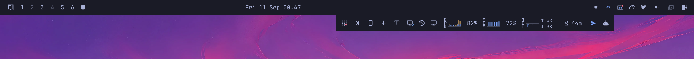
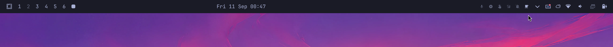
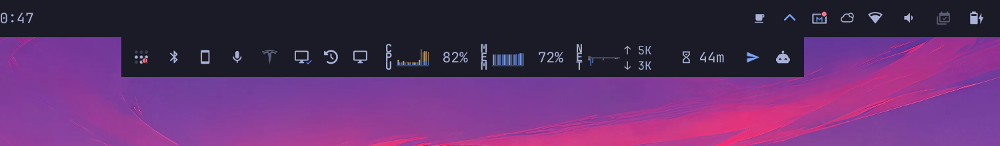

<p align="center">
  
</p>

# MacNook

A bar drawer for **notched Apple Omarchy** panels.

Favorites stay on the bar. Everything else lives in a tray that opens
*below* the camera shelf — flush against it, never through it.

`david.macnook` · MIT · based on [Katsari/nook](https://github.com/Katsari/nook)

<p align="center">
  
</p>

<p align="center"><em>Closed — the chevron is the drawer. Favorites stay put.</em></p>

<p align="center">
  
</p>

<p align="center"><em>Open — widgets you rarely touch, one click away, bar layout unchanged.</em></p>

## Install

```sh
omarchy plugin add https://github.com/Skeptomenos/macnook.git --enable
```

Then drag widgets onto the chevron, or set `trigger` to `"click"` if you do not want hover-open.

```sh
omarchy plugin update david.macnook
omarchy restart shell
```

## Why MacNook

MacNook is its own plugin, not a drop-in replacement for Nook. Upstream Nook is the right choice on a panel without a camera cutout.

| | Nook | MacNook |
| --- | --- | --- |
| Notch | Offsets by icon-row height, so the tray can sit in the cutout | Offsets by the **bar window** (the camera shelf) and sits flush |
| Hidden widgets | Leave empty holes | Collapse (updates, layout, AirPods) |
| Pinned tray | Stays open until you click | Autohides 10s after the pointer leaves |
| Plugin id | `io.github.katsari.nook` | `david.macnook` |

## Use

- **Hover** the chevron to peek. **Click** to pin it open; click again to put it away.
- **Drag** a bar widget onto the chevron to file it. Drag inside the tray to reorder. Drag out onto the bar to restore it. A caret marks the landing spot. A short press stays a click.
- **Autohide.** A pinned tray closes 10 seconds after the pointer leaves, unless a hosted panel is open or you are dragging. Set `hideAfter` to `0` to keep it pinned.
- **Click** a widget in the tray the same way you would on the bar. Panels anchor to the tray while it is open.

Every move writes `~/.config/omarchy/shell.json`.

## Settings

On MacNook's `bar.layout` entry:

| Key | Default | Meaning |
| --- | --- | --- |
| `items` | `[]` | Widgets inside the tray |
| `trigger` | `"hover"` | `"hover"` opens on pointer-over; anything else is click-only |
| `duration` | `180` | Reveal animation, ms |
| `hideAfter` | `10000` | Close a pinned tray this many ms after the pointer leaves; `0` disables |

The tray's layer surface is named `macnook`, for Hyprland layer rules.

<details>
<summary>Layout example</summary>

Per-widget settings go on the item, same shape as a bar entry. An `exec` item runs a command on an interval; a `source` item loads a QML file. Those are not plugins, so they do not need `plugins[]`.

```json
{
  "id": "david.macnook",
  "trigger": "click",
  "hideAfter": 10000,
  "items": [
    { "id": "some.widget" },
    { "id": "another.widget", "format": "short" }
  ]
}
```

Editing `items` by hand also needs each widget in top-level `plugins[]`, or it stays disabled. Dragging does both.

</details>

## Commands

```bash
omarchy-shell david.macnook toggle     # also: open, close
omarchy-shell david.macnook absorb <id>
omarchy-shell david.macnook eject <id>
omarchy-shell david.macnook reorder <from> <to>
omarchy-shell david.macnook status
```

`reorder` uses insertion indexes among the widgets the tray draws, from zero. `reorder 0 3` puts the first widget third.

`status` separates a wrong drawer state from a pointer that never arrived.

## Remove

```sh
omarchy plugin remove david.macnook
```

Eject the tray first. Removing a full MacNook leaves those widgets in `items` and off the bar.

<details>
<summary>Tests</summary>

```sh
tests/all.sh
```

GitHub Actions runs the node tests and source checks on every push. Lint and the QML harness need the Omarchy shell source and a Wayland session, so they skip on CI and run locally.

`tests/layoutmodel.test.js` covers every `shell.json` edit in `LayoutModel.js`. `tests/qml.test.sh` lints the QML, checks it against the library, and loads the widget against a mock bar.

Pointer-driven drag is opt-in and seizes the mouse for about twenty seconds:

```sh
tests/all.sh --drag
```

Build the virtual pointer once with `tests/tools/vptr/build.sh`. `shell.json` is snapshotted and restored, pass or fail.

</details>

<details>
<summary>Known limits</summary>

Built for Omarchy 4.0.3. MacNook reaches into the bar's widget registry, slot and click-target bookkeeping, and drag state. Those are not a public plugin API. 4.0.3 stopped handing third-party widgets the real bar, so MacNook adopts it from a first-party sibling; on a bar with no first-party widget it sits inert.

- **One MacNook per bar.** `allowMultiple` is false. A hand-written second copy would still load and both would write to the first entry they find.
- **Bottom and right bars can misroute a bar click.** `Bar.moduleClickTargetAt` maps clicks into every registered target's geometry without checking window. On those two edges the tray overlaps the bar's coordinate range. The chevron is covered; other bar widgets are not.
- **Bar CLI does not see inside the tray.** `omarchy bar set`, `omarchy bar move`, and `omarchy-shell shell listPlugins` read `bar.layout`. A hosted widget reads as absent. Eject it to configure it from the command line.
- **Panel numbers skip hosted widgets.** `omarchy-shell shell togglePanelAt` counts panels visible in a bar section. Summon by id still works: `omarchy-shell shell summon <id>` opens the tray and the panel.

</details>

## Credits

MacNook started as a fork of [Nook](https://github.com/Katsari/nook) by Katsari (MIT). The drawer, nested widget loading, drag model, and persistence are theirs. The notch flush, crash-safe layer, hidden-cell collapse, autohide, and this plugin identity are this tree's.
